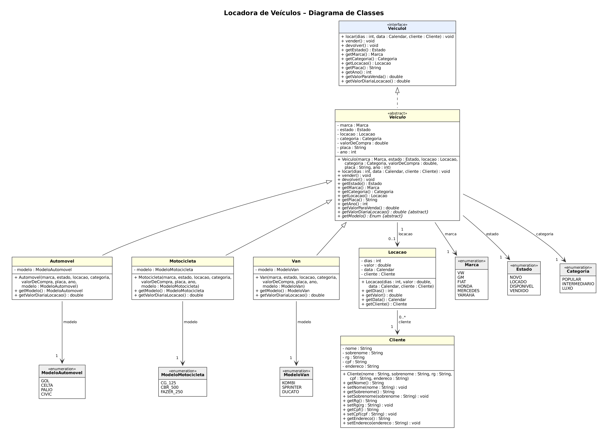

# Locadora de Veículos

Sistema de locadora de veículos em Java com Swing (MVC + DAO), desenvolvido como trabalho prático da disciplina de Linguagem de Programação Orientada a Objetos I (LPOO I) – UFPR.

O sistema gerencia o ciclo de vida dos veículos da empresa (automóveis, motocicletas e vans): da compra, passando pelas locações, até a venda. Os dados ficam armazenados em memória durante a execução.

## Funcionalidades

- **Clientes:** incluir, atualizar, excluir e listar clientes. Um cliente com veículo locado não pode ser excluído.
- **Veículos:** cadastrar veículos novos, com marca, estado, categoria, modelo, valor de compra e placa.
- **Locação:** buscar o cliente por nome, sobrenome ou CPF, filtrar veículos disponíveis por tipo, marca e categoria, e locar informando a data e a quantidade de dias.
- **Devolução:** listar os veículos locados e devolvê-los, deixando-os disponíveis de novo.
- **Venda:** filtrar veículos disponíveis e vendê-los pelo valor calculado conforme a idade do veículo.

## Tecnologias

- Java (JDK 8 ou superior)
- Java Swing, com tabelas em `AbstractTableModel`
- Apache NetBeans (projeto Java with Ant)

## Conceitos de orientação a objetos aplicados

- **Herança:** `Automovel`, `Motocicleta` e `Van` herdam da classe abstrata `Veiculo`.
- **Interface:** `Veiculo` implementa `VeiculoI`.
- **Polimorfismo:** cada tipo de veículo calcula a própria diária em `getValorDiariaLocacao()` e as telas manipulam todos como `Veiculo`.
- **Enums:** `Marca`, `Estado`, `Categoria` e os modelos de cada tipo de veículo.

## Estrutura do projeto

```
src/
└── locadora/
    ├── Main.java          → ponto de entrada da aplicação
    ├── model/             → Veiculo, Automovel, Motocicleta, Van, Locacao, Cliente e VeiculoI
    │   └── enums/         → Marca, Estado, Categoria, ModeloAutomovel, ModeloMotocicleta, ModeloVan, TipoVeiculo
    ├── dao/               → armazenamento em memória (ClienteDAO, VeiculoDAO)
    ├── controller/        → regras de uso de cada tela (cliente, veículo, locação)
    ├── exception/         → exceções de regra de negócio
    ├── util/              → formatação de moeda e data
    └── view/              → telas Swing
        └── tablemodel/    → modelos das tabelas (AbstractTableModel)
```

## Como executar

**Pelo NetBeans**

1. Clone o repositório e abra a pasta do projeto em **File > Open Project…**.
2. Execute com **Run > Run Project (F6)**.

**Pelo arquivo .jar**

1. No NetBeans, gere o executável com **Run > Clean and Build Project (Shift + F11)**.
2. O arquivo é criado em `dist/`. Execute com dois cliques ou pelo terminal:

```
java -jar dist/LocadoraVeiculos.jar
```

## Diagrama de classes



## Equipe

Felipe Fernandes de Azevedo
Vitor Savi do Nascimento